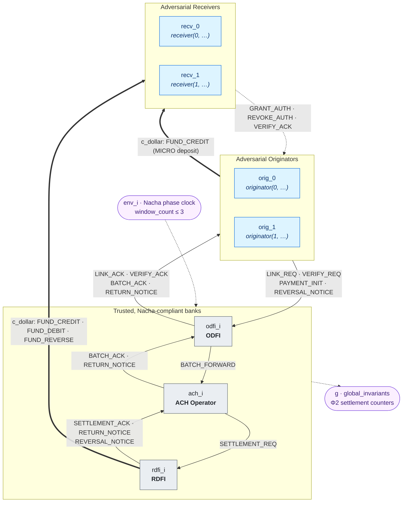
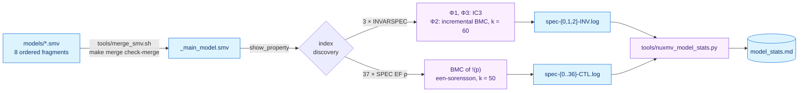

# Credit Without Debit

Formal verification models and reproducible checks for ACH payment flows.

<p align="center">
  <a href="https://zenodo.org/records/22701199"></a>
  
  
  
  
  <a href="LICENSE"></a>
</p>

The artifact connects the paper’s payment-system obligations to executable formal models.

<p align="center">
  
</p>

## What is this?

Artifact for the ACM CCS 2026 paper **Credit Without Debit: Formal Verification of Banking Payment Systems**, by Ali Hamza Malik and Muhammad Taqi Raza, University of Massachusetts Amherst. NuSMV/nuXmv models describe Automated Clearing House (ACH) payment flow; scripts merge, verify and summarize results in Markdown. Credit Without Debit (CWD) encompasses A1 creditBLEED (Φ1), A2 creditMINT (Φ2) and A3 creditRESET (Φ3).

- **Maintained version:** this repository, <https://github.com/alirafiqmalik/ach-model-checking>
- **Archived version:** Zenodo record [22701199](https://zenodo.org/records/22701199) (DOI [10.5281/zenodo.22701199](https://doi.org/10.5281/zenodo.22701199))

## At a glance

| Item | Value |
| --- | --- |
| Model fragments | 8 |
| Participants | 2 Originators, 2 Receivers, ODFI, ACH Operator, RDFI |
| Checks | 40: 3 INVARSPEC + 37 EF |
| Reference safety results | Φ1–Φ3 all violated |
| Reference EF results | 29 true, 4 false, 4 bounded-inconclusive |

The composition joins participant state machines through control and monetary channels.


<sub>Instances and parameters from <code>MODULE main</code> in <code>models/99_main.smv</code>; message routes from the <code>c_info_req_*</code> / <code>c_dollar_req_*</code> assignments in each participant module. All <code>c_info</code> traffic shares one single-slot bus; all money movement shares the <code>c_dollar</code> bus.</sub>

The runner merges fragments, checks properties and compiles results.



## Quick start

Run from the repository root with Docker, or use the bundled binary on Linux/macOS with Bash, make, Python 3 and diff:

```bash
./run_all_artifact.sh
# Native alternative:
./run_all_artifact.sh --no-docker
# Compose alternative:
ARTIFACT_CPUS=4 ARTIFACT_MEMORY=8g JOBS=3 docker compose run --build --rm artifact
```

A complete run can take hours. See [pipeline setup, modes, resources and troubleshooting](docs/verification-pipeline.md).

## Results summary

The nuXmv 2.1.0 reference run contains all 40 results. Bounded-inconclusive EF results do not establish unreachability.

<p align="center">
  
</p>

| Property | Attack | Unified index | Engine | Result | Counterexample | Log |
| --- | --- | --- | --- | --- | --- | --- |
| Φ1 Continuous Authorization | A1 creditBLEED | 37 | IC3 | false | 10 states | [`spec-0-INV.log`](saved-reference-results/local-run-20261029-artifact-reviews/spec-0-INV.log) |
| Φ2 Zero-Sum Invariant | A2 creditMINT | 38 | incremental BMC, k = 60 | false | 30 states | [`spec-1-INV.log`](saved-reference-results/local-run-20261029-artifact-reviews/spec-1-INV.log) |
| Φ3 Settlement Finality | A3 creditRESET | 39 | IC3 | false | 9 states | [`spec-2-INV.log`](saved-reference-results/local-run-20261029-artifact-reviews/spec-2-INV.log) |

The Φ2 counterexample replays the creditMINT sequence: the micro-deposit credit settles and the account is linked, then the recovery debit is returned `R16`, which leaves one settled credit and no settled debit in the verification cycle. See the [step-by-step walkthrough](saved-reference-results/README.md#creditmint-witness) and the [property semantics](docs/properties.md).

<p align="center">
  
</p>

## Documentation

| Document | Purpose |
| --- | --- |
| [Model architecture](models/README.md) | Participants, channels, assumptions and extensions |
| [Verification pipeline](docs/verification-pipeline.md) | Commands, environment, outputs and troubleshooting |
| [Properties](docs/properties.md) | Safety obligations, reachability and verdict semantics |
| [Reference results](saved-reference-results/README.md) | Provenance, all 40 results and integrity checks |
| [Tools](tools/README.md) | Utility interfaces and binary licensing |

## Repository layout

Source fragments, tools and retained results occupy separate repository directories.

```text
ach-model-checking/
├── README.md                     ← you are here
├── run_all_artifact.sh           # one-command pipeline: merge → nuXmv checks → stats
├── Makefile                      # merge · check-merge · verify · smoke · test · clean
├── Dockerfile                    # debian:bookworm-slim, linux/amd64, nuXmv + python3
├── compose.yaml                  # resource-limited Compose service "artifact"
├── docker/entrypoint.sh          # container entry → run_all_artifact.sh --inside-docker
├── models/                       # the formal model, merged in filename order  → models/README.md
│   ├── 00_types_channels.smv     #   c_info / c_dollar buses, env phase clock
│   ├── 10_originator.smv         #   Originator FSM + transaction_slot
│   ├── 20_odfi.smv               #   ODFI
│   ├── 30_ach_operator.smv       #   ACH Operator
│   ├── 40_rdfi.smv               #   RDFI
│   ├── 50_receiver.smv           #   Receiver
│   ├── 60_global_constraints.smv #   global observer for Φ2
│   └── 99_main.smv               #   composition, Φ1–Φ3, 37 EF witnesses, JUSTICE
├── tools/                        # merge, statistics, smoke test, nuXmv binaries  → tools/README.md
├── tests/fixtures/minimal/       # two-fragment model used by `make test`
├── docs/                         # layered documentation + figures (docs/assets/)
└── saved-reference-results/      # complete reference run with logs and provenance → saved-reference-results/README.md
```

## Data and privacy

Our empirical evaluation uses real consumer bank accounts owned by members of the research team. Raw account screenshots and transaction logs cannot be shared publicly because they contain personally identifiable financial information. The paper provides the redacted screenshots documenting the user-visible state changes for each CWD instance (A1: creditBLEED Attack, A2: creditMINT Attack, and A3: creditRESET Attack).

## Citation

```bibtex
@inproceedings{malik2026credit,
  title = {Credit Without Debit: Formal Verification of Banking Payment Systems},
  author = {Malik, Ali Hamza and Raza, Muhammad Taqi},
  booktitle = {Proceedings of the ACM Conference on Computer and Communications Security},
  year = {2026}
}
```

To cite the artifact itself, use the Zenodo record: <https://doi.org/10.5281/zenodo.22701199>.

## License

[MIT](LICENSE) covers model sources and scripts. Bundled nuXmv binaries are FBK’s and are shipped as provided under their own licensing terms.
