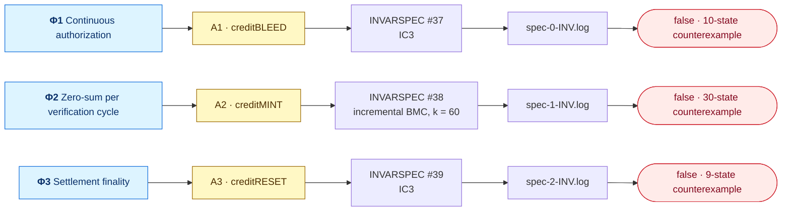
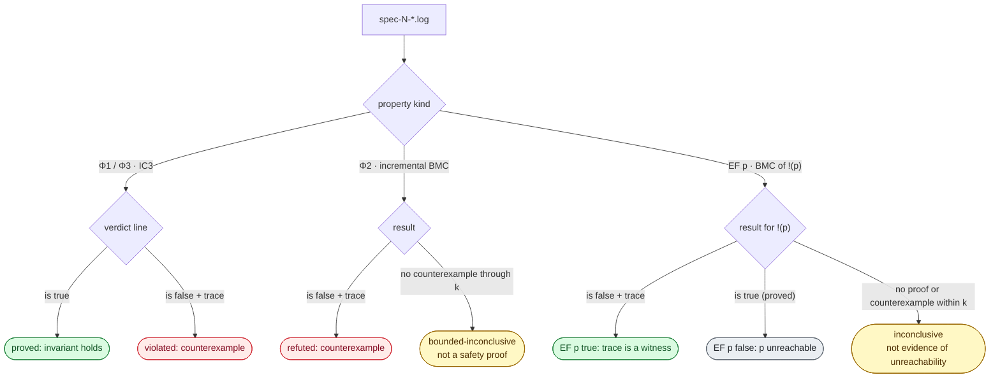

[← Artifact README](../README.md)

# Properties and verdicts

The model declares three safety invariants and 37 reachability witnesses.

Contents

- [Paper properties](#paper-properties)
- [EF coverage](#ef-coverage)
- [Verdicts](#verdicts)
- [Fairness](#fairness)

## Paper properties

The paper maps each safety obligation to one CWD attack.


<sub>Indices from <code>show_property.txt</code>; trace lengths from <code>audit.json</code> of the reference run.</sub>

### Paper properties and attack witnesses

The three `INVARSPEC`s are Φ1–Φ3. Their unified indices are 37–39 after the 37 CTL reachability properties. An unrestricted invariant counterexample need not contain every step of the corresponding paper attack.

For micro-deposit linking, each Originator submits a MICRO credit and its recovery debit to the same freely selected `link_target_r`. The two local slots record membership in this verification cycle. Entry outcomes still follow the existing Operator and RDFI transitions: neither successful settlement nor a debit return is prescribed. After credit settlement, the provider links and keeps that verification account active until the pair is terminal.

Φ2 checks settled-credit/debit equality separately for each provider's linked-account verification cycle, before the return window closes. A history latch records that this account was linked, so leaving the linking state cannot erase the obligation. This replaces the previous global MICRO aggregation, which could match a credit against an unrelated provider's or account's debit. Regular-class balance retains the existing global-cycle condition. This is a specification and verification-protocol correction, not just a change of search engine. It does not assert global MICRO balance for arbitrary manual/web-linked payments.

The normal command checks this Φ2 directly and saves its counterexample as `spec-1-INV.log`. The saved trace has 30 states: Originator 1, Receiver 1, credit settlement at 21, confirmation at 22, linkage at 23, and debit return `R16` at 30. The other Originator submits nothing. No additional creditMINT query, fixed account selection, return-code constraint, private helper, or extra command is used. The source retains both Originators and both Receivers.

This provider policy abstracts the Receiver confirmation exchange; the separate ODFI TPS handshake remains outside that abstraction. The model covers one verification pair per provider. Repeated-cycle amplification remains empirical.

| Paper | Attack | Invar # | Log | Interpretation |
| --- | --- | --- | --- | --- |
| Φ1 | A1: creditBLEED | 37 | spec-0-INV.log | Authorization at submission and throughout the pipeline, plus the existing RDFI/return predicate. A full provisional-debit/R16 sequence requires a targeted witness. |
| Φ2 | A2: creditMINT | 38 | spec-1-INV.log | Per-provider, per-account verification-cycle imbalance after linkage. The saved ordinary Φ2 trace shows the creditMINT sequence. |
| Φ3 | A3: creditRESET | 39 | spec-2-INV.log | Issuer card posting makes resources available before the return window expires. |

The declarations in `99_main.smv` apply these obligations to the composed model.

<details open>
<summary><b>The three <code>INVARSPEC</code>s, verbatim from <code>models/99_main.smv</code></b></summary>

```text
-- Φ1 Continuous Authorization (A1: creditBLEED Attack).
INVARSPEC ( phi1_ok_tx0 & phi1_ok_tx1 & phi1_ok_tx2 & phi1_ok_tx3 );

-- Φ2: each provider's linked-account verification cycle must balance.
INVARSPEC
  ( (orig_0.verification_cycle_complete ->
       orig_0.verification_credits = orig_0.verification_debits)
  & (orig_1.verification_cycle_complete ->
       orig_1.verification_credits = orig_1.verification_debits)
  & (g.cycle_complete -> g.n_credits_regular = g.n_debits_regular) );

-- Φ3 Settlement Finality (A3: creditRESET Attack).
INVARSPEC
  ( (resource_released_tx0 -> env_i.return_window_expired)
  & (resource_released_tx1 -> env_i.return_window_expired)
  & (resource_released_tx2 -> env_i.return_window_expired)
  & (resource_released_tx3 -> env_i.return_window_expired) );
```

</details>

<details>
<summary><b>Φ1 helper definitions (one per transaction slot; <code>tx0</code> shown)</b></summary>

```text
phi1_rdfi_eligible_tx0 :=
    (orig_0.tx_0.receiver_id = 0
      & !(rdfi_i.r0_account_status in {FROZEN, DEBIT_BLOCKED}))
  | (orig_0.tx_0.receiver_id = 1
      & !(rdfi_i.r1_account_status in {FROZEN, DEBIT_BLOCKED}));

phi1_authorized_tx0 :=
    !(   orig_0.tx_0.payment_state = returned
       & orig_0.tx_0.return_code = R16
       & !phi1_rdfi_eligible_tx0 );

phi1_ok_tx0 := orig_0.tx_0.entry_settled ->
    (phi1_authorized_tx0 & orig_0.tx_0.submitted_while_authorized
                         & !orig_0.tx_0.revoked_during_pipeline);

resource_released_tx0 := orig_0.tx_0.resource_available;   -- Φ3 helper
```

</details>


## EF coverage

Reachability checks cover milestones, rather than exhaustive transition coverage.

<p align="center">
  
</p>

| Module | Unified indices | Checks |
| --- | --- | --- |
| Originator and slots | 0–7 | 8 |
| Receiver | 8–13 | 6 |
| ODFI | 14–20 | 7 |
| ACH Operator | 21–23 | 3 |
| RDFI | 24–28 | 5 |
| Environment | 29–30 | 2 |
| Global observer | 31–36 | 6 |

## Verdicts

Quick mode writes `spec-{0,1,2}-INV.log` and `spec-*-CTL.log`. The driver prints a terminal summary. In an INV log, search for invariant is true, is false, or a counterexample. For an IC3 invariant, true is a proof and false is a counterexample. A false verdict precedes its trace, so it need not be the final line. Progress messages alone are not a verdict.

CTL logs decide `EF p` by BMC of `!(p)` (bound `BMC_K`, default 50). A counterexample is a witness, so `!(p)` false means the executability property is true. A proved true `!(p)` makes `EF p` false; no proof or counterexample through the bound is inconclusive, not evidence of unreachability.

`timing.tsv` is one line per INV job (local index, unified index, seconds). `timing.ctl.tsv` is the same for EF jobs.

EF results invert the verdict for the negated reachability target. A bounded search without a witness does not establish unreachability.




## Fairness

`JUSTICE env_i.window_count = 3` and `JUSTICE env_i.return_window_expired` constrain fair infinite paths to complete the scheduled windows. Φ3 uses `INVARSPEC`: its former CTL AG–AF formulation became vacuously true under fairness. Safety counterexamples remain finite prefixes.

## See also

[Models](../models/README.md) · [Pipeline](../docs/verification-pipeline.md) · [Properties](../docs/properties.md) · [Reference results](../saved-reference-results/README.md) · [Tools](../tools/README.md)
