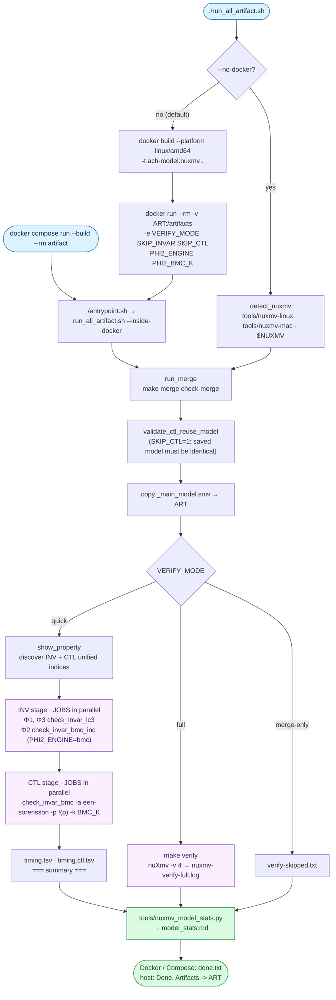
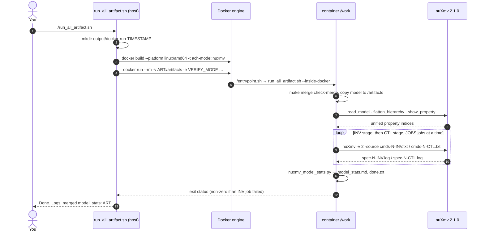

[← Artifact README](../README.md)

# Verification pipeline

The runner merges sources, discovers properties, checks them and compiles a Markdown report.

Contents

- [Workflow](#workflow)
- [Environment](#environment)
- [Property discovery and commands](#property-discovery-and-commands)
- [Outputs](#outputs)
- [Operational reference](#operational-reference)
- [Troubleshooting](#troubleshooting)

## Workflow

Quick mode runs the invariant stage first, then EF jobs in batches limited by `JOBS`, and finally statistics.


<sub>Source: <code>run_all_artifact.sh</code> (<code>run_host_docker</code>, <code>run_host_no_docker</code>, <code>run_inside_docker</code>, <code>run_verify_quick</code>), <code>Dockerfile</code>, <code>compose.yaml</code>, <code>docker/entrypoint.sh</code>. With <code>SKIP_INVAR=1</code> or <code>SKIP_CTL=1</code> the corresponding stage keeps the existing logs.</sub>

Docker builds a Debian Bookworm image and invokes the same runner through `docker/entrypoint.sh`; the host output directory is mounted at `/artifacts`.




## Environment

| Variable | Default |
| --- | --- |
| `IMAGE_NAME` | `ach-model:nuxmv` |
| `DOCKER_PLATFORM` | `linux/amd64` |
| `VERIFY_MODE` | `quick` |
| `ARTIFACT_DIR` | `native: output/local-run-<timestamp>; Docker: output/docker-run-<timestamp>; Compose: output/compose-run; container: /artifacts` |
| `OUTPUT_ROOT` | `$ROOT/output` |
| `MERGED_MODEL` | `$OUTPUT_ROOT/_main_model.smv` |
| `NUXMV` | `tools/nuxmv-linux on Linux; tools/nuxmv-mac on Darwin; container /work/tools/nuxmv-linux` |
| `JOBS` | `SLURM_CPUS_PER_TASK if set, otherwise 9; Compose 3` |
| `VERB` | `2` |
| `BMC_K` | `50` |
| `PHI2_ENGINE` | `bmc` |
| `PHI2_BMC_K` | `60` |
| `SKIP_INVAR` | `0 (unset is inactive)` |
| `SKIP_CTL` | `0 (unset is inactive)` |
| `ARTIFACT_CPUS` | `4 (Compose)` |
| `ARTIFACT_MEMORY` | `8g (Compose)` |

The wrapper Docker invocation forwards verification mode, skip flags and Φ2 settings, but does not forward host `JOBS`, `BMC_K`, `VERB`, `NUXMV`, `OUTPUT_ROOT` or `MERGED_MODEL`. Compose forwards `JOBS` and `BMC_K`. `MERGED_MODEL` selects the runner’s input path, while merge uses Makefile `OUTPUT_DIR`; keep these paths aligned or configure Makefile `OUTPUT` explicitly.

## Property discovery and commands

The runner flattens the merged model and parses `show_property` to discover unified indices. Local INV filenames use 0–2, while commands currently select unified indices 37–39.

Each check runs as its own nuXmv batch script. These are the three templates in `run_all_artifact.sh` (`$MODEL` is the merged model, `$gidx` the unified index found by `show_property`):

<table>
<tr><th>Φ1 / Φ3 · IC3 proof or counterexample</th><th>Φ2 · incremental BMC (<code>PHI2_ENGINE=bmc</code>)</th><th>EF p · BMC of <code>!(p)</code></th></tr>
<tr valign="top"><td>

```text
set on_failure_script_quits
read_model -i $MODEL
flatten_hierarchy
encode_variables
build_boolean_model
go_msat
check_invar_ic3 -n $gidx
quit
```

</td><td>

```text
set on_failure_script_quits
read_model -i $MODEL
flatten_hierarchy
encode_variables
build_boolean_model
go_bmc
check_invar_bmc_inc -a falsification \
    -n $gidx -k $PHI2_BMC_K
quit
```

</td><td>

```text
set on_failure_script_quits
read_model -i $MODEL
flatten_hierarchy
encode_variables
build_boolean_model
go_bmc
check_invar_bmc -a een-sorensson \
    -p "!(<atom>)" -k $BMC_K
quit
```

</td></tr>
</table>

The scripts are written next to their logs as `cmds-<i>-INV.txt` and `cmds-<i>-CTL.txt`; the reference copies are in [`saved-reference-results/local-run-20261029-artifact-reviews/`](../saved-reference-results/local-run-20261029-artifact-reviews/).

IC3 uses `go_msat` and `check_invar_ic3 -n <index>`. Φ2 defaults to `go_bmc` and `check_invar_bmc_inc -a falsification -n 38 -k 60`. EF jobs use `check_invar_bmc -a een-sorensson -p "!(<target>)" -k 50` after Boolean encoding.

## Outputs

Each retained run contains the merged model, generated command scripts, property listing, logs, timings and statistics.

```text
output/
├── _main_model.smv                     # make merge (shared by all runs)
└── local-run-<YYYYmmdd-HHMMSS>/        # or docker-run-<…>/, compose-run/, or $ARTIFACT_DIR
    ├── _main_model.smv                 # exact model checked by this run
    ├── cmds-show_property.txt          # index discovery script …
    ├── show_property.txt               # … and its output
    ├── cmds-{0,1,2}-INV.txt            # Φ1, Φ2, Φ3 scripts
    ├── spec-{0,1,2}-INV.log            # Φ1, Φ2, Φ3 verdicts + counterexamples
    ├── cmds-{0..36}-CTL.txt            # EF scripts
    ├── spec-{0..36}-CTL.log            # EF verdicts + witness traces
    ├── timing.<i>.tsv  timing.ctl.<i>.tsv
    ├── timing.tsv  timing.ctl.tsv      # merged: local index · unified index · seconds
    ├── model_stats.md                  # model size + property sheet
    ├── done.txt                        # Docker / Compose runs only
    ├── verify-skipped.txt              # VERIFY_MODE=merge-only only
    └── nuxmv-verify-full.log           # VERIFY_MODE=full only
```

`done.txt` is written by the container path; the native path prints completion without creating it. Statistics failures are tolerated by the runner, so inspect the report and logs even after completion.

## Operational reference

The following reference material is carried over from the original artifact README. For the repository layout, see the [root README](../README.md#repository-layout).

### Requirements

- Docker, or macOS / Linux with `bash`, `make`, `python3`, and `diff`.
- nuXmv binaries in `tools/`, included with the paper bundle:
  - Linux (Docker or host): `tools/nuxmv-linux` (executable)
  - macOS without Docker: `tools/nuxmv-mac` (executable)

`docker build` fails if `tools/nuxmv-linux` is missing. Copy the binaries from the artifact bundle, then `chmod +x tools/nuxmv-linux` (and `nuxmv-mac` if you use the host binary).

### Run

From the repo root:

```bash
./run_all_artifact.sh
```

Builds the image and merges the model. Checks run next; outputs go to `output/docker-run-<timestamp>/`.

Without Docker (`tools/nuxmv-linux` on Linux, `tools/nuxmv-mac` on macOS):

```bash
./run_all_artifact.sh --no-docker
```

Outputs go to `output/local-run-<timestamp>/` unless you set a path:

```bash
ARTIFACT_DIR=./output/custom-run ./run_all_artifact.sh --no-docker
```

`make merge` writes `output/_main_model.smv`. Pipeline jobs write logs and `model_stats.md` into the same `output/` tree (one directory per run). The whole `output/` directory is gitignored.

#### Docker Desktop resources and Compose

The reference host has 16 logical CPUs and 15 GiB of RAM. A complete run can take hours, depending on the model, hardware and concurrent jobs. In Docker Desktop, inspect **Settings → Resources → Advanced** and allocate enough CPUs and memory for the container limits below, leaving memory for the host. With the WSL 2 backend, configure the WSL VM allocation instead. See [Docker Desktop resource settings](https://docs.docker.com/desktop/settings-and-maintenance/settings/#resources).

The optional Compose service defaults to 4 CPUs, an 8 GiB memory limit and 3 concurrent checker jobs. These are configurable starting values, not a measured minimum requirement. Reduce `JOBS` when memory is constrained; increasing the container limit cannot increase Docker Desktop's VM allocation.

```bash
ARTIFACT_CPUS=4 ARTIFACT_MEMORY=8g JOBS=3 docker compose config
ARTIFACT_CPUS=4 ARTIFACT_MEMORY=8g JOBS=3 docker compose run --build --rm artifact
```

Compose outputs default to `output/compose-run/`; set `ARTIFACT_DIR` to a fresh host directory for each retained run. `VERIFY_MODE`, `BMC_K`, `SKIP_INVAR`, `SKIP_CTL`, `PHI2_ENGINE` and `PHI2_BMC_K` are also forwarded. The existing `./run_all_artifact.sh` Docker command remains available; Compose resource limits apply when using Compose. See [Compose CPU and memory limits](https://docs.docker.com/reference/compose-file/services/).

#### Verification modes

Set `VERIFY_MODE` before the command:

| Value        | What it does                                                                  |
| ------------ | ----------------------------------------------------------------------------- |
| `quick`      | Default. IC3 on Φ1/Φ3, incremental BMC on Φ2, then BMC on each `SPEC EF`. Writes the property sheet. |
| `full`       | Runs `make verify` (verbose nuXmv on the merged model).                       |
| `merge-only` | Merge only; skips nuXmv. Still writes `model_stats.md` where possible.        |

Example:

```bash
VERIFY_MODE=full ./run_all_artifact.sh --no-docker
```

The default quick run uses incremental BMC for the per-account verification-cycle Φ2 invariant:

```bash
./run_all_artifact.sh --no-docker
```

`PHI2_ENGINE` defaults to `bmc`, with `PHI2_BMC_K=60`. Set `PHI2_ENGINE=ic3` to use IC3 for Φ2 instead. The engine option changes only the checking algorithm. Both engines check the declared Φ2 property directly on the model, without an auxiliary query or search restrictions. A BMC counterexample conclusively refutes Φ2. No counterexample through `PHI2_BMC_K` is only bounded-inconclusive, not a safety proof. Φ1/Φ3 still use IC3, and all EF checks retain their existing method and `BMC_K` bound. The same options work with Docker and Compose.

### Results and verdict strings

The script prints the artifact directory when it finishes. In quick mode, `spec-1-INV.log` is written during the initial invariant stage, so the Φ2 trace can be inspected while the EF reachability checks continue.

| File / folder           | Meaning                                                                                      |
| ----------------------- | -------------------------------------------------------------------------------------------- |
| `_main_model.smv`       | Single merged model (same as `output/_main_model.smv`).                                      |
| `model_stats.md`        | Model size plus a table of every Invar and `EF` property when logs exist.                     |
| `spec-*-INV.log`        | Quick-mode invariant logs (IC3 for Φ1/Φ3; incremental BMC for Φ2 by default).             |
| `spec-*-CTL.log`        | BMC logs for each `EF p` (k-induction of `!(p)`).                                             |
| `done.txt`              | Docker / Compose runs only: confirms the container finished.                                 |
| `verify-skipped.txt`    | Present only if `VERIFY_MODE=merge-only`.                                                    |
| `nuxmv-verify-full.log` | Only for `VERIFY_MODE=full`: full console log from `make verify`.                            |

Quick mode writes `spec-{0,1,2}-INV.log` and `spec-*-CTL.log`. The driver prints a terminal summary. In an INV log, search for invariant is true, is false, or a counterexample. For an IC3 invariant, true is a proof and false is a counterexample. A false verdict precedes its trace, so it need not be the final line. Progress messages alone are not a verdict.

CTL logs decide `EF p` by BMC of `!(p)` (bound `BMC_K`, default 50). A counterexample is a witness, so `!(p)` false means the executability property is true. A proved true `!(p)` makes `EF p` false; no proof or counterexample through the bound is inconclusive, not evidence of unreachability.

`timing.tsv` is one line per INV job (local index, unified index, seconds). `timing.ctl.tsv` is the same for EF jobs.

To add EF logs to an existing INV run without repeating Φ1–Φ3:

```bash
SKIP_INVAR=1 ARTIFACT_DIR=./output/local-run-<timestamp> ./run_all_artifact.sh --no-docker
```

To rerun invariants while retaining completed EF logs for the **same merged model**:

```bash
SKIP_CTL=1 ARTIFACT_DIR=./output/local-run-<timestamp> ./run_all_artifact.sh --no-docker
```

Use either skip option only when the retained logs and `_main_model.smv` belong to the current model. Start a fresh artifact directory after changing the model. `SKIP_CTL=1` rejects a missing or mismatched saved model and missing CTL logs or timings. These options reuse existing results; they do not rerun skipped checks.

### Makefile targets

| Target             | Action                                                    |
| ------------------ | --------------------------------------------------------- |
| `make merge`       | Build `output/_main_model.smv` from `models/*.smv`.       |
| `make check-merge` | Ensures merge output matches joining the parts in order.  |
| `make smoke`       | Loads merged model and flattens (fast sanity check).      |
| `make test`        | Tiny merge + nuXmv batch (needs a `tools/` nuXmv binary). |
| `make clean`       | Removes generated merge files (not the rest of `output/`). |


## Troubleshooting

If nuXmv is missing, obtain the bundled platform binary and make it executable with `chmod +x tools/nuxmv-linux` (or `tools/nuxmv-mac`). Docker build requires the Linux binary. If Docker is unavailable, install/start Docker or use `--no-docker`. On memory exhaustion, reduce `JOBS` and inspect Docker/WSL memory allocation. `make verify` runs verbose batch checking; `make all` performs merge and check-merge. `SKIP_INVAR` has no corresponding model/log validation guard: verify retained inputs yourself.

## See also

[Models](../models/README.md) · [Pipeline](../docs/verification-pipeline.md) · [Properties](../docs/properties.md) · [Reference results](../saved-reference-results/README.md) · [Tools](../tools/README.md)
