[← Artifact README](../README.md)

# Model architecture

Eight ordered SMV fragments define the bounded ACH system.

Contents

- [Composition](#composition)
- [Channels](#channels)
- [Environment](#environment)
- [Originator](#originator)
- [Transaction slot](#transaction-slot)
- [ODFI](#odfi)
- [ACH Operator](#ach-operator)
- [RDFI](#rdfi)
- [Receiver](#receiver)
- [Global observer](#global-observer)
- [Assumptions and limits](#assumptions-and-limits)
- [Extension](#extension)

## Composition

`main` instantiates two Originators, two Receivers, one ODFI, one ACH Operator, one RDFI, two buses and a global observer.

```mermaid
flowchart LR
    ENV["env_i : env<br/>phase clock"]
    subgraph PARTS["participants"]
        direction LR
        subgraph RECV["Receivers"]
            direction TB
            R0["recv_0 : receiver(0, c_info, env_i)"]
            R1["recv_1 : receiver(1, c_info, env_i)"]
        end
        subgraph ORIG["Originators"]
            direction TB
            O0["orig_0 : originator(0, …, recv_0, recv_1)"]
            O1["orig_1 : originator(1, …, recv_0, recv_1)"]
        end
        BO["odfi_i : odfi(…, orig_0, orig_1)"]
        A["ach_i : ach_operator(…, odfi_i)"]
        BR["rdfi_i : rdfi(…, ach_i, recv_0, recv_1)"]
        RECV --> ORIG --> BO --> A --> BR
        RECV --> BR
    end
    subgraph BUS["buses"]
        direction TB
        CI[["c_info : c_info_channel(7 participants)"]]
        CD[["c_dollar : c_dollar_channel(7 participants)"]]
    end
    G{{"g : global_invariants(env_i, 7 participants)"}}
    ENV --> PARTS
    PARTS -. "c_*_req_* fields" .-> BUS
    BUS -. "bus state" .-> PARTS
    PARTS --> G
    ENV --> G

    classDef adv fill:#ddf4ff,stroke:#0969da,color:#0a3069
    classDef bank fill:#eaeef2,stroke:#57606a,color:#1f2328
    classDef aux fill:#fbefff,stroke:#8250df,color:#3e1f79
    class O0,O1,R0,R1 adv
    class BO,A,BR bank
    class ENV,CI,CD,G aux
```
An arrow <code>X → Y</code> means instance <code>X</code> is passed as a module parameter to <code>Y</code> (Y reads X); <code>env_i</code> is passed to every participant. The two channels take all seven participants as parameters, and every participant takes both channels. nuXmv has no cross-module writes: each module computes only its own <code>next(…)</code> from what it reads. Source: <code>VAR</code> block of <code>MODULE main</code>, <code>models/99_main.smv</code>.

| File | MODULE(s) | Role | Lines |
| --- | --- | --- | --- |
| [00_types_channels.smv](00_types_channels.smv) | `c_info_channel`, `c_dollar_channel`, `env` | Shared buses and logical phases | 321 |
| [10_originator.smv](10_originator.smv) | `transaction_slot`, `originator` | Originator and transaction lifecycle | 860 |
| [20_odfi.smv](20_odfi.smv) | `odfi` | Originating bank validation and batching | 461 |
| [30_ach_operator.smv](30_ach_operator.smv) | `ach_operator` | Batch checking and routing | 329 |
| [40_rdfi.smv](40_rdfi.smv) | `rdfi` | Receiving bank settlement and returns | 402 |
| [50_receiver.smv](50_receiver.smv) | `receiver` | Authorization and account changes | 280 |
| [60_global_constraints.smv](60_global_constraints.smv) | `global_invariants` | Settlement counters and model constraints | 187 |
| [99_main.smv](99_main.smv) | `main` | Composition, fairness and properties | 227 |

## Channels

`c_info` carries control messages and `c_dollar` monetary messages. Each is a single-slot bus; competing requests use the ordered arbitration cases in `00_types_channels.smv`.

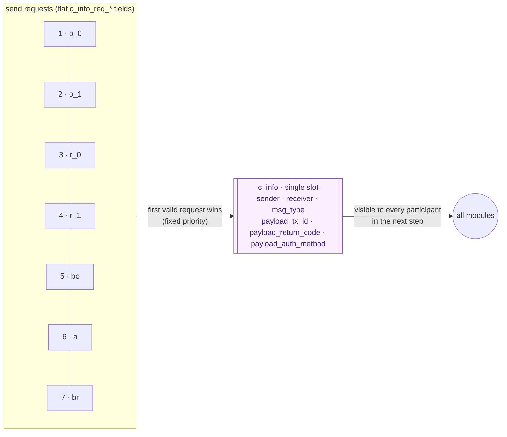

| Message | Bus | Sender → receiver | Emitted when (source) |
| --- | --- | --- | --- |
| `LINK_REQ` | `c_info` | Originator → `bo` | `fsm_state ∈ {linking_manual, linking_web, linking_micro}` (`10_originator.smv`) |
| `VERIFY_REQ` | `c_info` | Originator → `bo` | `fsm_state = verifying_tps_account` |
| `PAYMENT_INIT` | `c_info` | Originator → `bo` | `fsm_state = initiating_payment` |
| `REVERSAL_NOTICE` | `c_info` | Originator → `bo`; RDFI → `a` | `reversing`; RDFI `reversed_state` |
| `GRANT_AUTH` / `REVOKE_AUTH` | `c_info` | Receiver → target Originator | `considering_auth` / `considering_revoke` (`50_receiver.smv`) |
| `VERIFY_ACK` | `c_info` | Receiver → Originator; ODFI → tx owner | Receiver `confirmed_md`; ODFI `tps_verified` / `tps_rejected` |
| `LINK_ACK` | `c_info` | `bo` → link requester | ODFI `link_acked` |
| `BATCH_FORWARD` | `c_info` | `bo` → `a` | ODFI `batch_collecting` and `env.batch_expired` |
| `BATCH_ACK` | `c_info` | `a` → `bo`; `bo` → `o_k` | Operator `forwarded_ack`; ODFI `ack_o0` / `ack_o1` |
| `SETTLEMENT_REQ` | `c_info` | `a` → `br` | Operator enters `routing_to_rdfi` |
| `SETTLEMENT_ACK` | `c_info` | `br` → `a` | RDFI `settled_state` |
| `RETURN_NOTICE` | `c_info` | `br` → `a` → `bo` → tx owner | RDFI `returning`; Operator rejections / `return_processing`; ODFI `validation_rejected` / `processing_return` |
| `FUND_CREDIT` / `FUND_DEBIT` / `FUND_REVERSE` | `c_dollar` | `br` → `r_k` | RDFI `settled_state` (by `tx_code`) / `reversed_state` |
| `FUND_CREDIT` (`MICRO`) | `c_dollar` | Originator → linked Receiver | micro-deposit request (`c_dollar_req_valid`) |

## Environment

Nine ordered phases replace independent clock flags. The environment can stutter or advance, and the batch-window counter is bounded at three.

```mermaid
stateDiagram-v2
    direction LR
    [*] --> ph_idle
    ph_idle --> ph_batch_open : batch_started
    ph_batch_open --> ph_batch_closed : batch_expired, window_count + 1
    ph_batch_closed --> ph_settling : settlement_started
    ph_settling --> ph_settle_closed : settlement_expired
    ph_settle_closed --> ph_transfer_open : transfer_started
    ph_transfer_open --> ph_transfer_done : transfer_expired
    ph_transfer_done --> ph_return_open : return_window_started
    ph_return_open --> ph_return_closed : return_window_expired
    ph_return_closed --> ph_idle : next cycle, window_count below 3
    ph_return_closed --> ph_batch_open : next cycle, window_count below 3
    note right of ph_return_closed
        Absorbing once window_count = 3.
        Every phase may also stutter.
    end note
    classDef open fill:#ddf4ff,stroke:#0969da,color:#0a3069
    classDef closed fill:#ffebe9,stroke:#cf222e,color:#82071e
    class ph_batch_open,ph_settling,ph_transfer_open,ph_return_open open
    class ph_return_closed closed
```
Source: <code>MODULE env</code>, <code>next(phase)</code> and <code>next(window_count)</code> in <code>models/00_types_channels.smv</code>. Participants read the Boolean aliases on the edges (for example <code>env.batch_expired</code>), which stay TRUE for every later phase of the same cycle.

## Originator

Linking, micro-deposit verification, submission and reversal are coordinated by the Originator.

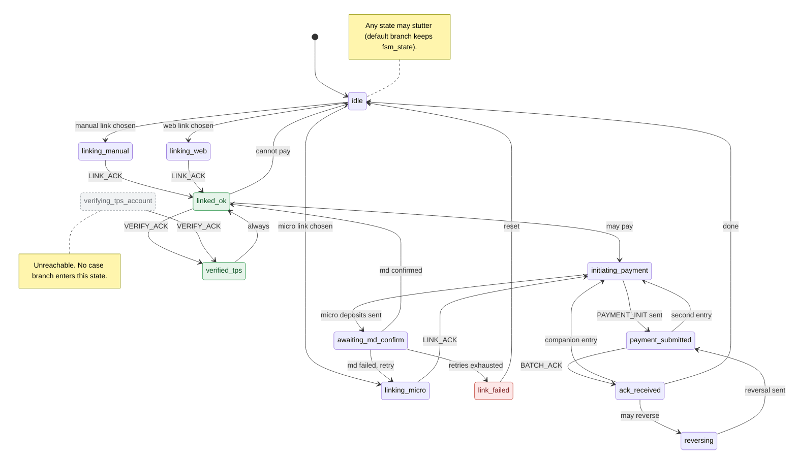
*Source: models/10_originator.smv, next(fsm_state) in MODULE originator.*

**Key guards**

| Transition | Guard |
|---|---|
| `idle` → `linking_*` | nondeterministic input `link_choice` picks method and receiver (`to_r0_*` / `to_r1_*`) |
| `linking_manual` / `linking_web` → `linked_ok` | `link_ack_from_bo` (LINK_ACK from `bo`) |
| `linking_micro` → `initiating_payment` | `link_ack_from_bo`; `md_state` moves to `md_sent_1` in the same step |
| `initiating_payment` → `awaiting_md_confirm` | `md_state = md_sent_1` (verification pair submitted); otherwise → `payment_submitted` |
| `awaiting_md_confirm` → `linked_ok` / `linking_micro` / `link_failed` | `md_state = md_confirmed`; or `md_failed` with `md_reinit_count < 3`; or `md_failed` with retries exhausted |
| `linked_ok` → `initiating_payment` | `tx_count < 2`, `any_receiver_authorized`, window not expired (nondet with staying); held while a verification pair is active and not terminal |
| `linked_ok` → `idle` | fallback when the payment guard fails (nondet with staying) |
| `payment_submitted` → `ack_received` | `batch_ack_for_me` (BATCH_ACK from `bo`) |
| `payment_submitted` / `ack_received` → `initiating_payment` | `tx_count < 2`, `any_receiver_authorized`, window not expired (nondet) |
| `ack_received` → `reversing` | an own slot is `settled`, `env.return_window_started`, window not expired, `tx_count < 2` (nondet with `idle`) |

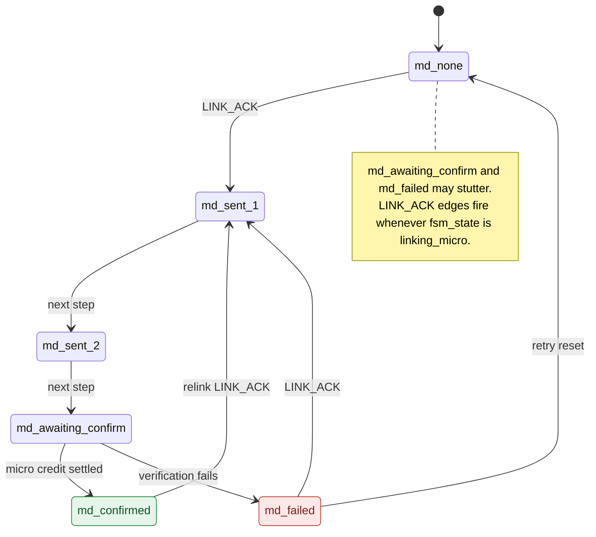
*Source: models/10_originator.smv, next(md_state) in MODULE originator.*

**Key guards**

| Transition | Guard |
|---|---|
| any → `md_sent_1` | `fsm_state = linking_micro` and `link_ack_from_bo` (first branch, no `md_state` guard) |
| `md_sent_1` → `md_sent_2` → `md_awaiting_confirm` | unconditional, one step each |
| `md_awaiting_confirm` → `md_confirmed` | a slot is `settled` with `tx_code = credit`, `amount = MICRO`, `receiver_id = link_target_r` |
| `md_awaiting_confirm` → `md_failed` | otherwise nondeterministic `{md_awaiting_confirm, md_failed}` |
| `md_failed` → `md_none` | `fsm_state = linking_micro` and `md_reinit_count < 3` (counter increments) |

## Transaction slot

Each Originator owns two slots. Slots update their own lifecycle from channel messages and owner helper signals; modules do not write another module’s state.

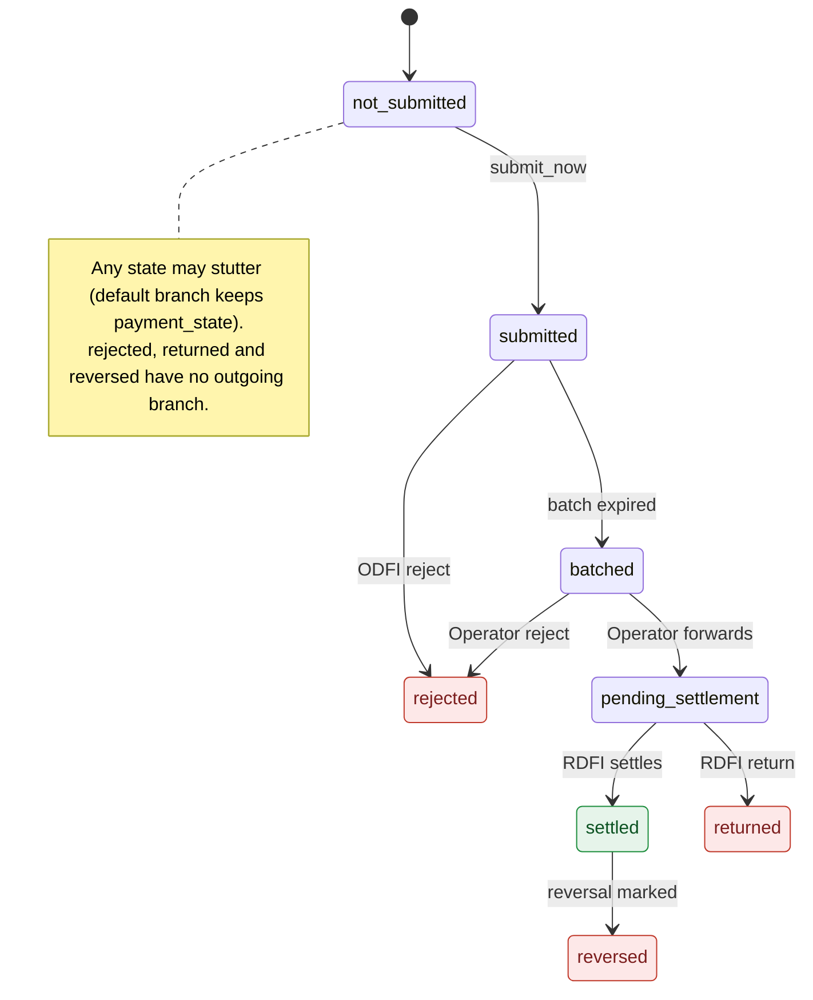
*Source: models/10_originator.smv, next(payment_state) in MODULE transaction_slot.*

**Key guards**

| Transition | Guard |
|---|---|
| `not_submitted` → `submitted` | owner raises `submit_now` and `env.return_window_expired` is false |
| `submitted` → `rejected` | ODFI validation failure: `return_notice_from_bo` (RETURN_NOTICE from `bo`) |
| `submitted` → `batched` | batch window closes: `env.batch_expired` |
| `batched` → `pending_settlement` | Operator accepts: `op_forward_for_me` (SETTLEMENT_REQ from `a`) |
| `batched` → `rejected` | Operator data rejection: `op_reject_for_me` (RETURN_NOTICE from `a`) |
| `pending_settlement` → `settled` | `rdfi_settle_for_me` (SETTLEMENT_ACK from `br`) and window not expired |
| `pending_settlement` → `returned` | `rdfi_return_for_me` (RETURN_NOTICE from `br`); `return_code` latched from payload |
| `settled` → `reversed` | `mark_reversed_now` (owner submits a reversal slot targeting this one) and `reversal_window_open` |

## ODFI

The trusted originating bank validates entries, collects batches and processes acknowledgments and returns.

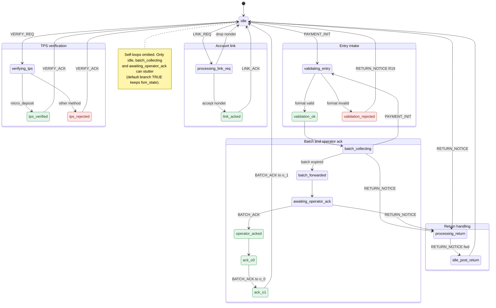
*Source: models/20_odfi.smv, next(fsm_state) in MODULE odfi.*

**Key guards**

| Transition | Guard (first matching `case` branch wins) |
|---|---|
| `idle` → `verifying_tps` / `validating_entry` / `processing_return` / `processing_link_req` | inbound `c_info` addressed to `bo` with `VERIFY_REQ` / `PAYMENT_INIT` / `RETURN_NOTICE` / `LINK_REQ` (`rx_*` DEFINEs) |
| `processing_link_req` → `link_acked` or `idle` | unconditional nondeterministic choice `{link_acked, idle}` ("commercially reasonable" check is underspecified) |
| `verifying_tps` → `tps_verified` | `verify_method_for_tps = micro_deposit` (latched from the `VERIFY_REQ` payload); otherwise → `tps_rejected` |
| `validating_entry` → `validation_ok` | `entry_would_validate`: SEC `WEB`, `debit`/`credit`, amount `MICRO`/`SMALL`/`LARGE`, and not (`u3_error_triggered` & `u3_variant = u3_reject_batch`) |
| `validating_entry` → `validation_rejected` | `!entry_would_validate`; on exit sends `RETURN_NOTICE` with `R19` to the tx owner |
| `batch_collecting` → `validating_entry` | another `PAYMENT_INIT` arrives (checked before `env.batch_expired`) |
| `batch_collecting` → `batch_forwarded` | `env.batch_expired`; sets `batch_submitted` and sends `BATCH_FORWARD` to `a` |
| `awaiting_operator_ack` → `operator_acked` | `BATCH_ACK` from the operator; then fan-out `ack_o0` → `ack_o1` (single-slot `c_info`) |
| `batch_collecting` / `awaiting_operator_ack` → `processing_return` | `RETURN_NOTICE` addressed to `bo` |
| `processing_return` → `idle_post_return` | unconditional; forwards `RETURN_NOTICE` to `last_tx_owner` |

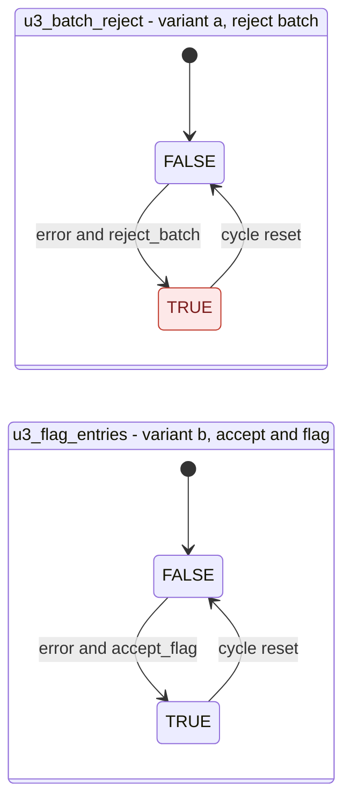
*Source: models/20_odfi.smv, next(u3_batch_reject) and next(u3_flag_entries) in MODULE odfi.*

**Key guards**

| Transition | Guard |
|---|---|
| `u3_batch_reject` FALSE → TRUE | `fsm_state = validating_entry` & `u3_error_triggered` & `u3_variant = u3_reject_batch` (the same entry also fails validation → `validation_rejected`) |
| `u3_flag_entries` FALSE → TRUE | `fsm_state = validating_entry` & `u3_error_triggered` & `u3_variant = u3_accept_flag` & `entry_format_valid_by_enum` (entry still passes → `validation_ok`) |
| either flag TRUE → FALSE | cycle boundary: `fsm_state = operator_acked` or `fsm_state = idle_post_return` |
| inputs | `u3_error_triggered` and `u3_variant` are chosen nondeterministically on each `PAYMENT_INIT` intake (from `idle` or `batch_collecting`); `u3_error_triggered` is cleared in `validation_ok` / `validation_rejected` |

Whole-batch rejection of the other slots driven by `u3_batch_reject` is cascaded in `models/60_global_constraints.smv`, not in this FSM.

## ACH Operator

The trusted Operator chooses compliant batch-checking variants, routes accepted entries and forwards returns.

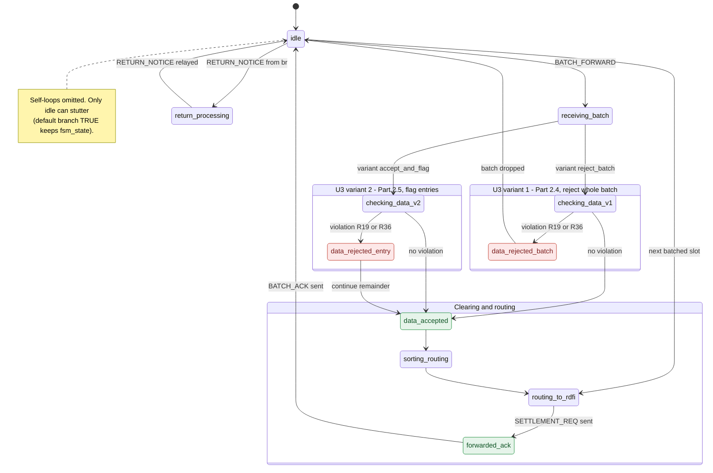
*Source: models/30_ach_operator.smv, next(fsm_state) in MODULE ach_operator.*

**Key guards**

| Transition | Guard (first matching `case` branch wins) |
|---|---|
| `idle` → `receiving_batch` | `rcv_batch_forward` (`BATCH_FORWARD` from `bo` to `a`) & `any_tx_in_batch` |
| `idle` → `return_processing` | `rcv_return_notice` (`RETURN_NOTICE` from `br` to `a`) & `any_tx_in_pipeline` |
| `idle` → `routing_to_rdfi` | `any_tx_in_batch` & `!any_tx_pending` & no inbound `BATCH_FORWARD`/`RETURN_NOTICE`: routes the remaining batched slot of a multi-entry batch |
| `receiving_batch` → `checking_data_v1` / `checking_data_v2` | input variable `u3_variant` = `variant_reject_batch` / `variant_accept_and_flag` (chosen per step) |
| `checking_data_v1` → `data_rejected_batch` | `batch_has_violation` (some batched slot has `env_tx_malformed_i`); `return_code_for_rejected` := nondet `{R19, R36}` |
| `checking_data_v2` → `data_rejected_entry` | `batch_has_violation`; same nondet `R19`/`R36` |
| `checking_data_v1`/`v2` → `data_accepted` | `!batch_has_violation` |
| `data_rejected_batch` → `idle` / `data_rejected_entry` → `data_accepted` | unconditional; `RETURN_NOTICE` to `bo` is emitted on entering either rejection state |
| `routing_to_rdfi` → `forwarded_ack` → `idle` | unconditional; `SETTLEMENT_REQ` to `br` on entering `routing_to_rdfi`, `BATCH_ACK` to `bo` on entering `forwarded_ack` |
| `return_processing` → `idle` | unconditional; relays the RDFI's `payload_return_code` to `bo` on entry |

## RDFI

The trusted receiving bank settles or returns entries according to account status and handles reversals inside the return window.

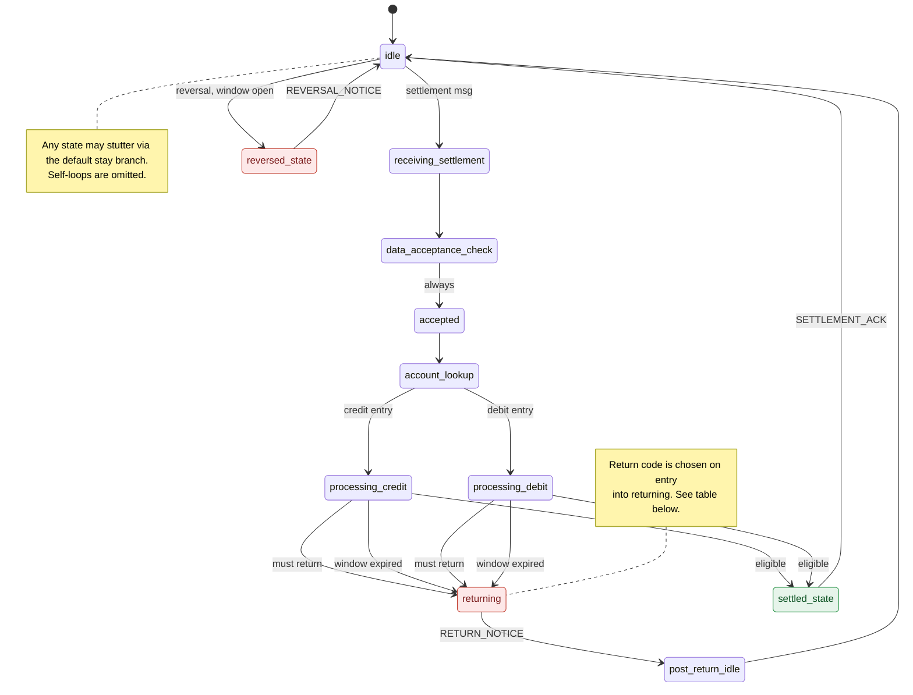
*Source: models/40_rdfi.smv, next(fsm_state) in MODULE rdfi.*

**Key guards**

| Transition | Guard (plain words) |
|---|---|
| `idle` → `receiving_settlement` | `_inbound_settlement`: Operator `a` sent `BATCH_FORWARD` or `SETTLEMENT_REQ` to `br` |
| `idle` → `reversed_state` | `_inbound_reversal` (`REVERSAL_NOTICE` from `a`) and `_reversal_window_open` (`!env.return_window_expired`); checked first |
| `data_acceptance_check` → `accepted` | Unconditional; R19/R36 rejection is modelled on the Operator side |
| `account_lookup` → `processing_credit` / `processing_debit` | Latched `_hand_code` of slot `last_processed_tx_id` is `credit` / `debit` |
| `processing_*` → `returning` (must return) | `_must_return`: status `CLOSED`, `NO_ACCOUNT`, `INVALID_ACCOUNT_NUMBER`, `UNAUTHORIZED`; or `FROZEN`/`DEBIT_BLOCKED` on a debit; or `CREDIT_BLOCKED` on a credit |
| `processing_*` → `returning` (window expired) | `env.return_window_expired` and not `_must_return`: nondeterministic `{processing_*, returning}`; settlement is refused |
| `processing_*` → `settled_state` | Neither `_must_return` nor `env.return_window_expired` |
| `settled_state` → `idle` | Unconditional; emits `SETTLEMENT_ACK` to `a` and `FUND_CREDIT`/`FUND_DEBIT` to the Receiver |
| `returning` → `post_return_idle` → `idle` | Unconditional; `returning` emits `RETURN_NOTICE` carrying `selected_return_code` |

**Return codes selected (`next(selected_return_code)`, set while in `processing_*`)**

`_current_acct_status` is `r0_account_status` or `r1_account_status` of the targeted Receiver. Both start nondeterministic over all 9 values and are re-chosen only while that Receiver is in `account_state_changed` and no transaction is `batched`/`pending_settlement`.

| Entry | Account status | Code(s) |
|---|---|---|
| Debit | any must-return status (`CLOSED`, `NO_ACCOUNT`, `INVALID_ACCOUNT_NUMBER`, `UNAUTHORIZED`, `FROZEN`, `DEBIT_BLOCKED`) | `R08` or `R16` (first case branch, wins for every debit) |
| Credit | `CLOSED` | `R02` |
| Credit | `NO_ACCOUNT` | `R03` |
| Credit | `INVALID_ACCOUNT_NUMBER` | `R04` |
| Credit | `UNAUTHORIZED` | `R07` or `R08` |
| Credit | `CREDIT_BLOCKED` | `R02` |
| Either | `ACTIVE`, `DORMANT` (and `FROZEN`/`DEBIT_BLOCKED` on a credit) | none (`none_rc`), entry settles |

`R01`, `R19` and `R36` are never selected by the RDFI. `R10` and `R29` only appear in branches that the earlier debit branch shadows.

## Receiver

Adversarial Receivers grant or revoke authorization, respond to micro-deposits and change account state.

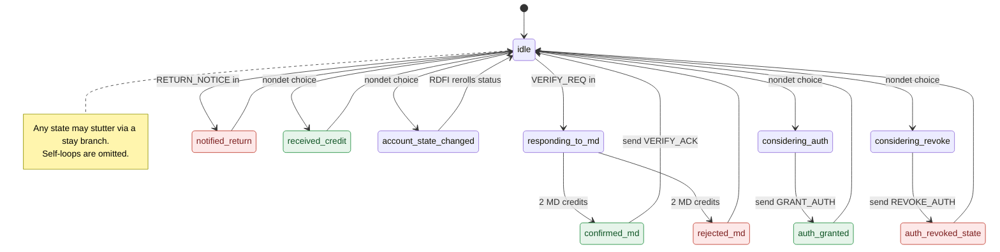
*Source: models/50_receiver.smv, next(fsm_state) in MODULE receiver.*

**Key guards**

| Transition | Guard (plain words) |
|---|---|
| `idle` → `responding_to_md` | `_inbound_verify_req`: `VERIFY_REQ` addressed to `_self`; records `md_pending_for_originator` from the sender (`o_0`/`o_1`); checked first |
| `idle` → `notified_return` | `_inbound_return_notice`: `RETURN_NOTICE` addressed to `_self` |
| `idle` → `considering_auth` / `considering_revoke` / `received_credit` / `account_state_changed` | No inbound message: nondeterministic pick from `{idle, considering_auth, considering_revoke, received_credit, account_state_changed}`; `target_originator` and `chosen_link_method` are also re-chosen nondeterministically |
| `considering_auth` → `auth_granted` | Unconditional; sets `authorized_originators_<target>` and `link_method_used_<target>` := `chosen_link_method`, sends `GRANT_AUTH` |
| `considering_revoke` → `auth_revoked_state` | Unconditional (no check that the Originator was authorized); clears authorization, sends `REVOKE_AUTH` |
| `responding_to_md` → `confirmed_md` / `rejected_md` | `md_received_credits = 2`, then a nondeterministic choice; credits increment nondeterministically while `env.settlement_started` |
| `confirmed_md` → `idle` | Unconditional; sends `VERIFY_ACK` to the target Originator; resets MD counters |
| `account_state_changed` → `idle` | Unconditional; while in this state the RDFI may re-choose `r<id>_account_status` if no transaction is in the pipeline |

## Global observer

`60_global_constraints.smv` counts settled MICRO, SMALL and LARGE credits and debits over four slots. SMALL and LARGE form the regular class. A returned debit does not count as settled. `cycle_complete` requires a nonempty cycle, no pending pipeline entries and an open return window. Constraints bound simultaneously submitted entries at three, require same-class origination pairing and prevent return-window expiry with pending entries. Φ2 uses provider-local MICRO counters and the global regular-class balance.

## Assumptions and limits

Banks and the Operator follow the modeled rules; Originators and Receivers make adversarial nondeterministic choices. `Compromised_any := FALSE`. Amount classes, bounded slots and logical phases abstract monetary values, unbounded workloads and elapsed time. There is one verification pair per provider. The provider credit-success linking policy abstracts the Receiver confirmation exchange; the separate ODFI TPS handshake remains outside that abstraction. Repeated-cycle amplification remains empirical.

## Extension

Add an SMV fragment and list it explicitly in `MODEL_PARTS` in the root Makefile in dependency order. Instantiate its modules in `99_main.smv`, update relevant properties, then run `make merge check-merge smoke`. Start a fresh results directory after changing the model.

## See also

[Models](../models/README.md) · [Pipeline](../docs/verification-pipeline.md) · [Properties](../docs/properties.md) · [Reference results](../saved-reference-results/README.md) · [Tools](../tools/README.md)
