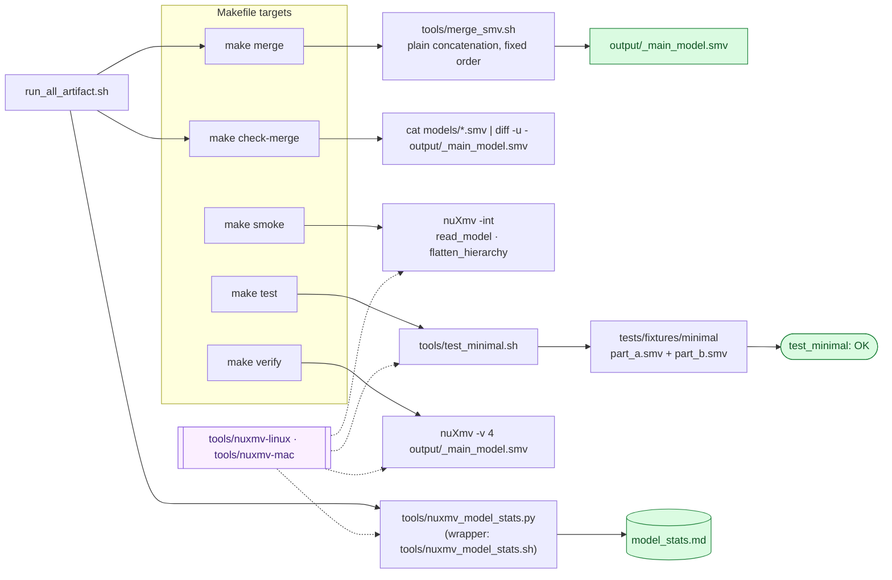

[← Artifact README](../README.md)

# Tools

These utilities concatenate models, exercise a minimal fixture and summarize nuXmv output.

Contents

- [Flow](#flow)
- [Commands](#commands)
- [Statistics](#statistics)
- [Binaries and licensing](#binaries-and-licensing)

## Flow

The Makefile calls the merger; the artifact runner calls nuXmv and the Python statistics collector.




## Commands

| Tool | Interface and behavior |
| --- | --- |
| `merge_smv.sh` | `<output.smv> <part1.smv> [part2.smv ...]`; plain ordered concatenation, no separators; rejects missing inputs |
| `nuxmv_model_stats.py` | `[model] [--nuxmv PATH] [--output PATH / -o PATH] [--log-dir DIR]` |
| `nuxmv_model_stats.sh` | Changes to repository root and forwards all arguments to Python |
| `test_minimal.sh` | Honors `NUXMV` or searches bundled executable names; merges two fixture parts and runs batch loading with no specifications |

The Python model argument defaults to `output/_main_model.smv`; output defaults to `model_stats.md`. Binary selection uses `--nuxmv`, then `NUXMV`, then the platform-specific binary under `tools/`. Static collection runs BDD/FSM statistics, variable counts and usage commands. Dynamic collection reads the property listing, property logs and timing tables, maps local to unified indices, and translates negated EF verdicts.

```bash
python3 tools/nuxmv_model_stats.py output/_main_model.smv --log-dir output/custom-run --output output/custom-run/model_stats.md
make test
```

The minimal fixture toggles a Boolean; it checks concatenation and model loading, not ACH behavior. Its generated `_merged_test.smv` is removed by `make clean`; diagnostic output is `/tmp/nuxmv_minimal.log`.

## Statistics

The generated report separates static model measurements from dynamic property verdicts. Use the reference report to inspect the recorded output format.

<details open>
<summary><b>Excerpt of <code>model_stats.md</code> from the reference run</b></summary>

```markdown
# nuXmv model statistics

## Static (after `go`)

| Metric | Value |
| --- | --- |
| nuXmv exit code (static batch) | 0 |
| Number of Frozen Variables | 0 |
| Number of Input Variables | 11 |
| Number of State Variables | 197 |
| Number of bits (summary) | 417 (0 frozen, 15 input, 402 state) |
| Number of BDD variables | 820 |
| BDD nodes representing init set of states | 391 |
…

## Properties

CTL `EF p` is BMC of `!(p)`: a counterexample means the executability property is true.

| # | Kind | Name | Formula | Result | Time (s) | Log |
| --- | --- | --- | --- | --- | --- | --- |
| 0 | CTL |  | EF orig_0.fsm_state = linked_ok | true | 3.000 | spec-0-CTL.log |
…
| 38 | Invar | Φ2 Zero-Sum Invariant (A2: creditMINT Attack) | (((orig_0.verification_cycle_complete -> … | false | 33.000 | spec-1-INV.log |
```

</details>


## Binaries and licensing

| Binary | Platform | Bytes |
| --- | --- | --- |
| `nuxmv-linux` | Linux | 52611120 |
| `nuxmv-mac` | macOS | 28468696 |

The artifact uses nuXmv 2.1.0; the Docker image targets `linux/amd64`. nuXmv is distributed by Fondazione Bruno Kessler under its own license. Repository `LICENSE` states that MIT covers model sources and scripts, while nuXmv binaries belong to FBK and are shipped as provided. Do not interpret the repository MIT license as relicensing those binaries.

## See also

[Models](../models/README.md) · [Pipeline](../docs/verification-pipeline.md) · [Properties](../docs/properties.md) · [Reference results](../saved-reference-results/README.md) · [Tools](../tools/README.md)
